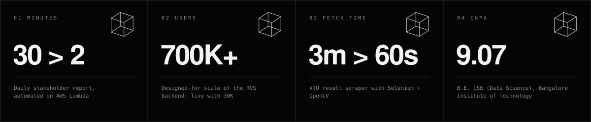
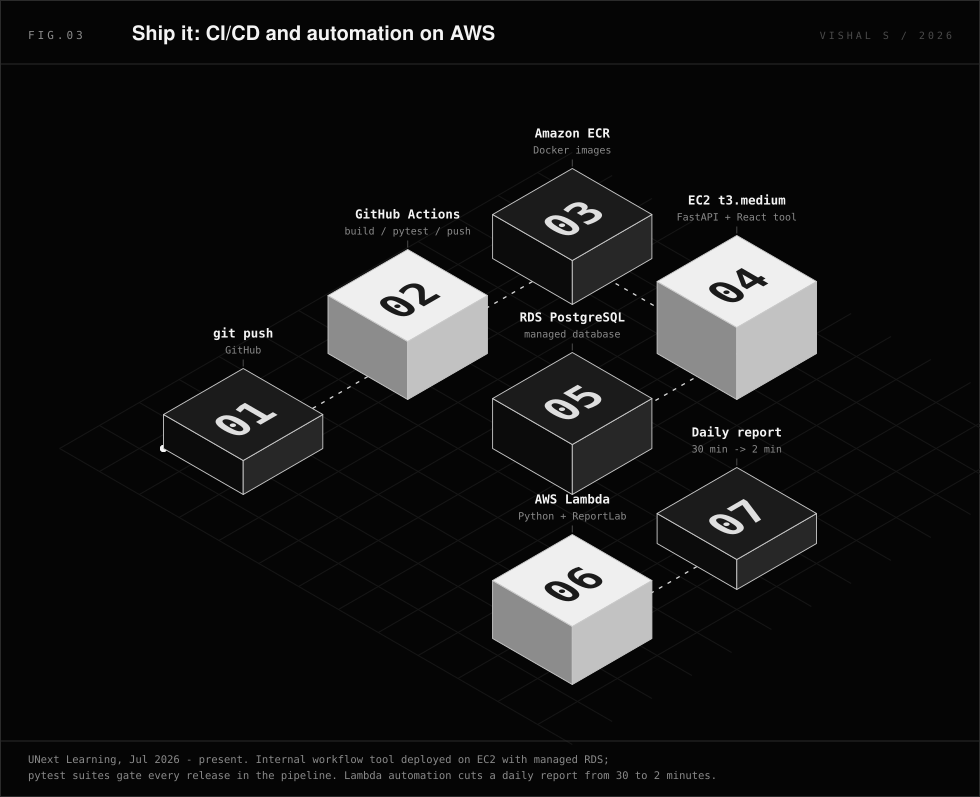
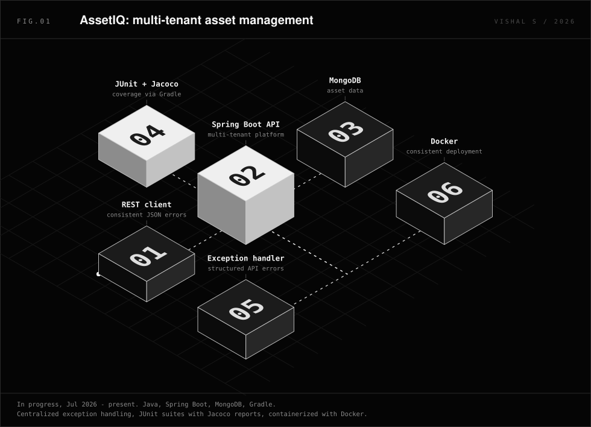
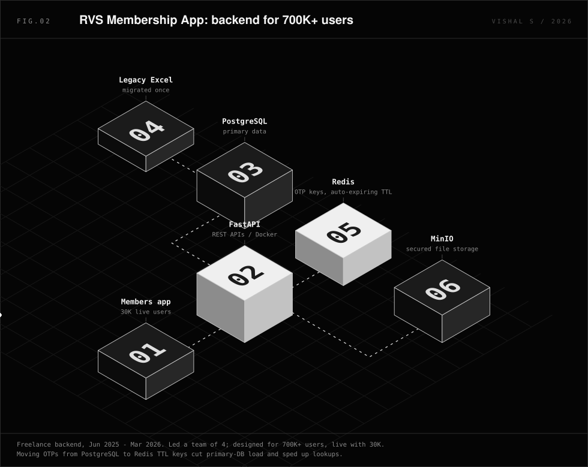
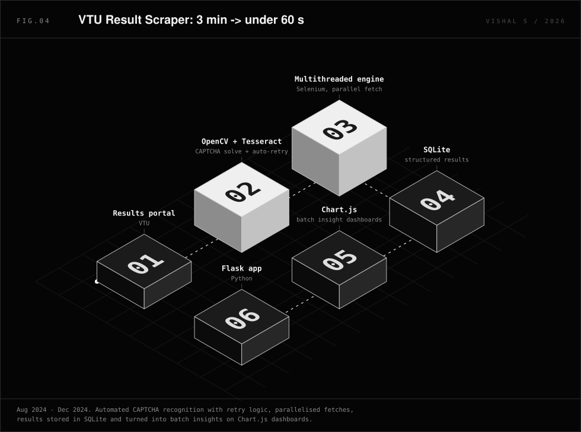
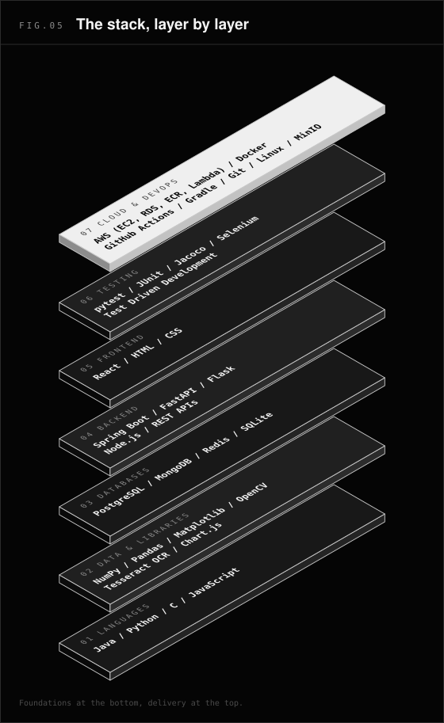
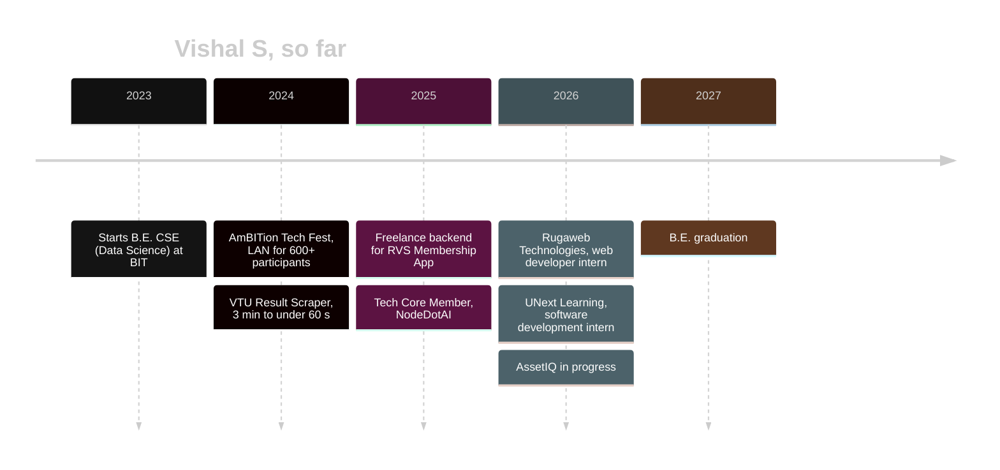

<div align="center">



<br>

[](https://github.com/v-9469)
[](https://www.linkedin.com/in/s-vishal-reddy)
[](mailto:svishalreddy2005@gmail.com)
[](https://v-9469.github.io/)

**[Experience](#experience) · [Selected work](#selected-work) · [The stack](#the-stack) · [Timeline](#timeline) · [Record](#record) · [Contact](#contact)**

</div>

---

## `00` Hello

I'm **Vishal S**, a Computer Science (Data Science) undergraduate in **Bengaluru** who builds backend services in **Java / Spring Boot** and **Python / FastAPI**, writes the automated tests that keep them honest, and ships them to **AWS** through **CI/CD**.



|  |  |
| :-- | :-- |
| **Now** | Software Development Intern at **UNext Learning** (Jul 2026 – present) · building **AssetIQ** |
| **Studying** | B.E. CSE (Data Science), Bangalore Institute of Technology · **CGPA 9.07** · 2023 – 2027 |
| **Strongest at** | REST APIs, containerized deployments, test suites that run in the pipeline |
| **Based in** | Bengaluru, Karnataka, India |

> The same visual language lives on the [live intro page](https://v-9469.github.io/): a drag-to-rotate Three.js torus, tilting project cards and a CSS-3D exploded stack.

---

## `02` Experience

### Software Development Intern · UNext Learning
`Jul 2026 – present` · Bengaluru
<sub>Python · FastAPI · PostgreSQL · React · AWS (EC2, RDS, ECR, Lambda) · Docker · GitHub Actions · pytest</sub>

- Built an end-to-end **AWS Lambda** automation (Python, ReportLab) that generates daily stakeholder-ready reports, cutting the process from **30 minutes to 2**.
- Built and deployed an internal workflow tool (**FastAPI, PostgreSQL, React**) on AWS: an **EC2 t3.medium** instance with a managed **RDS** database.
- Containerized services with **Docker**, published images to **Amazon ECR**, and set up a **GitHub Actions** CI/CD pipeline for build, test and deployment.
- Wrote **pytest** suites for API endpoints and business logic that run automatically in the pipeline and catch regressions before release.

<div align="center">
  
</div>

### Web Developer Intern · Rugaweb Technologies LLP
`Jun 2026 – Jul 2026` · Bengaluru
<sub>WordPress · React · HTML · CSS</sub>

- Resolved UI bugs and optimized layouts across client WordPress sites to improve performance.
- Developed interactive React and HTML/CSS prototypes to speed up client approval cycles.
- Delivered iterative updates from client feedback with **zero deployment downtime**.

### Freelance Backend Developer · RVS Membership App
`Jun 2025 – Mar 2026` · Remote
<sub>FastAPI · PostgreSQL · Redis · Docker · MinIO</sub>

- Led a **4-member team** building the backend of a trust-management system designed for **700K+ users**, live with **30K**.
- Built RESTful APIs with FastAPI, containerized services with Docker, and secured file storage via MinIO.
- Moved OTP storage from PostgreSQL to **Redis** (auto-expiring TTL keys), cutting primary-DB load and speeding up lookups.
- Migrated legacy Excel records into PostgreSQL with an optimized, error-free schema.

---

## `03` Selected work

Each figure below is a pure-SVG isometric scene: no JavaScript, animated with SMIL (dashed lines flow, packets travel along the edges), so it renders right here on GitHub.

### FIG.01 · AssetIQ
`Java` `Spring Boot` `MongoDB` `JUnit` `Jacoco` `Gradle` `Docker` · *in progress, Jul 2026 – present*

A multi-tenant asset management platform. Centralized exception handling gives every endpoint consistent, structured error responses; JUnit suites report coverage through Jacoco and run via Gradle; the app is containerized for consistent deployment.

<div align="center">
  
</div>

### FIG.02 · RVS Membership App
`FastAPI` `PostgreSQL` `Redis` `Docker` `MinIO` · *Jun 2025 – Mar 2026*

Backend for a trust-management system designed for 700K+ users and live with 30K. The interesting decision: OTPs moved from PostgreSQL into Redis keys with a TTL, so expiry is automatic and the primary database stops carrying short-lived writes.

<div align="center">
  
</div>

### FIG.03 · Cloud report automation
`AWS Lambda` `Python` `ReportLab` `EC2` `RDS` `ECR` `GitHub Actions` · *UNext Learning, Jul 2026 – present*

A daily stakeholder report that used to take 30 minutes by hand is now generated by a Lambda in about 2. See the [pipeline diagram above](#software-development-intern--unext-learning) for how the workflow tool ships alongside it.

### FIG.04 · VTU Result Scraper
`Python` `Flask` `Selenium` `OpenCV` `Tesseract` `SQLite` `Chart.js` · *Aug – Dec 2024* · [`v-9469/vtu-results`](https://github.com/v-9469/vtu-results)

Student result fetches dropped from about **3 minutes to under 60 seconds**. A multithreaded engine parallelizes extraction, an OpenCV + Tesseract pipeline solves CAPTCHAs with auto-retry, results land in SQLite, and Chart.js dashboards turn a batch into insights.

<div align="center">
  
</div>

<sub>Also on GitHub: [**Chess**](https://github.com/v-9469/Chess), an online chess game built with Python's pygame.</sub>

---

## `04` The stack

<table>
<tr>
<td width="46%" valign="top">

</td>
<td valign="top">

| Layer | What I use |
| :-- | :-- |
| **Languages** | Java, Python, C, JavaScript |
| **Backend** | Spring Boot, FastAPI, Flask, Node.js, REST APIs |
| **Frontend** | React, HTML, CSS |
| **Databases** | PostgreSQL, MongoDB, Redis, SQLite |
| **Cloud & DevOps** | AWS (EC2, RDS, ECR, Lambda), Docker, GitHub Actions (CI/CD), Gradle, Git, Linux, MinIO |
| **Testing** | pytest, JUnit, Jacoco, Selenium, Test Driven Development |
| **Libraries** | NumPy, Pandas, Matplotlib, OpenCV, Tesseract OCR, Chart.js |
| **Core** | Data Structures & Algorithms, OOP, Agile Development |

</td>
</tr>
</table>

---

## `05` Timeline



---

## `06` Record

**Education**

| Year | | |
| :-- | :-- | :-- |
| 2023 – 2027 | B.E. Computer Science and Engineering (Data Science) | Bangalore Institute of Technology · CGPA **9.07** |

**Achievements**

| Place | Event | Project |
| :-: | :-- | :-- |
| 🥇 1st | IoT Project Exhibition (CSE-DS) | Dynamic Traffic Control |
| 🥇 1st | Project Exhibition (CSE-DS) | FileTracker |
| 🥉 3rd | Project Exhibition (Mathematics Dept) | VTU Result Analysis |

**Positions of responsibility**

- **Tech Core Member, NodeDotAI, BIT** (Aug 2025 – May 2026): ran a DSA session for juniors on algorithms and problem-solving; delivered a hands-on NumPy & Pandas workshop with live coding.
- **On-ground Technical Personnel, AmBITion Tech Fest, BIT** (Jun 2024): managed routers, switches and LAN infrastructure across 10 classrooms for 600+ participants and kept connectivity uninterrupted.

---

## `07` Contact

| | |
| :-- | :-- |
| Email | [svishalreddy2005@gmail.com](mailto:svishalreddy2005@gmail.com) |
| GitHub | [github.com/v-9469](https://github.com/v-9469) |
| LinkedIn | [linkedin.com/in/s-vishal-reddy](https://www.linkedin.com/in/s-vishal-reddy) |
| Live page | [v-9469.github.io](https://v-9469.github.io/) |

---

<details>
<summary><b>How this repo is built</b></summary>

<br>

```text
.
├── README.md                 this file
├── index.html                the intro page (single file, GitHub Pages)
├── assets/
│   ├── hero.svg              animated 3D torus banner (real projected keyframes)
│   ├── metrics.svg           key numbers with rotating wireframe cubes
│   ├── arch-cloud.svg        isometric CI/CD + Lambda scene (FIG.03)
│   ├── arch-rvs.svg          isometric RVS backend
│   ├── arch-assetiq.svg      isometric AssetIQ
│   ├── arch-vtu.svg          isometric VTU scraper pipeline
│   └── skill-stack.svg       floating isometric skill layers
└── scripts/
    └── gen_assets.py         regenerates every SVG in assets/ (Python 3, no dependencies)
```

**Why SVG and not WebGL in the README?** GitHub strips JavaScript, so the 3D here is pre-computed. The torus is projected in Python for 19 rotation keyframes and animated with SMIL `<animate attributeName="d">`; the isometric scenes use a hand-written projection (`x → ↗`, `y → ↘`, `z → ↑`) and painter's-algorithm ordering. The [live page](https://v-9469.github.io/) uses real Three.js.

**Regenerate the art**

```bash
python3 scripts/gen_assets.py
```

**Publish the page**: Settings → Pages → *Deploy from a branch* → `main` / root. The page loads Three.js from a CDN and falls back to a 2D canvas renderer if WebGL is unavailable.

**Palette**: `#050505` background · `#f4f4f4` ink · `#8a8a8a` muted · `#2b2b2b` hairlines · one steel-blue accent (`#8fa8bf`), used only for links.

**Zero build, no lockfiles**: `package.json`, `package-lock.json`, `pnpm-lock.yaml`, `bun.lock` and `yarn.lock` are intentionally gitignored. The portfolio is a single dependency-free HTML file plus a Python SVG generator — nothing to install, nothing to bundle, nothing to rot.

</details>

<div align="center">
<sub>Monochrome grid · Bengaluru · 2026</sub>
</div>
